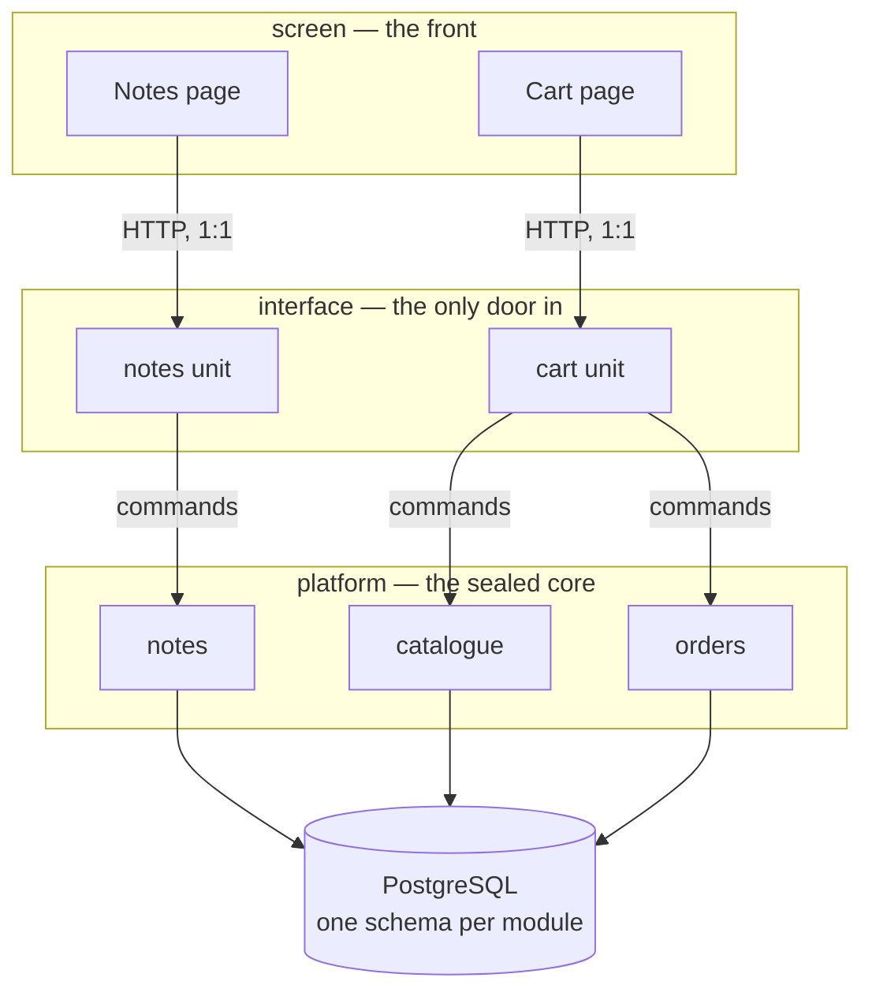
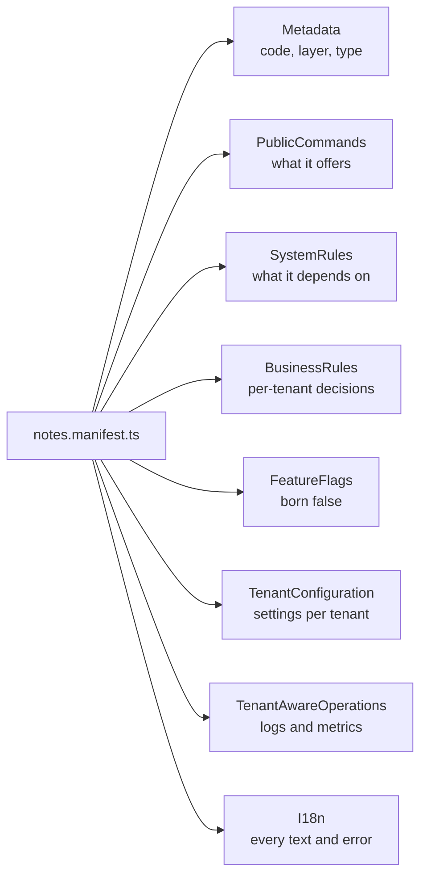

# Bucle Engine — showcase

A light, public window onto **Bucle Engine**, a multi-tenant business backend built on NestJS and
PostgreSQL. This repository explains what the Engine is, how its layers are drawn and how a module
describes itself in a manifest. It does **not** contain the Engine's source: the examples are toy
modules written for this showcase, and they run with Node alone.

> Resumen en español al final.

## What Bucle Engine is

Most backends grow around tables or endpoints. Bucle Engine grows around the **governed business
operation**: a module says, in one declarative manifest, which operations it offers, who may call
them, which texts and errors it shows, and which operations of other modules it depends on. The
runtime reads that declaration and enforces it; what a manifest does not declare does not reach a
tenant.

> The manifest declares → the runtime enforces → the database conforms.

It is a **modular monolith**: one application, many bounded modules, each owning its own data and
talking to the others only through declared commands. Splitting a module into its own process later
is a deployment decision, not a rewrite.

## What it powers

The same Engine, pinned as a dependency, runs every product of its line:

| Product | What it is |
|---|---|
| **mktp** | a marketplace where many sellers share one storefront |
| **single** | a store for one seller: catalogue, cart, checkout, its own admin |
| **fomo-control** | an operations console where projects are launched and followed through tickets |

Each product adds its own screens and connectors around the Engine; none of them edits the Engine
itself. No customer data lives in this repository or in its examples.

## Three layers

Inside the backend, every module belongs to exactly one layer, and the layer is part of its
manifest:



| Layer | Owns | Never does |
|---|---|---|
| **platform** | the tables and the domain rules of one area | expose a route; import another module |
| **interface** | the endpoints of ONE screen module or ONE external system | own a table; call another interface unit |
| **screen** | the pages of a front, grouped in modules | call `platform` directly |

**Why.** The core that every product shares stays pure: it has no HTTP surface at all, so nothing
outside can reach a table except through an operation the core chose to offer. Everything that
faces the outside — a page, a webhook, another service — gets its own interface unit, named after
whoever it serves. That unit may gather data from several platform modules and shape it for its
page, but it holds no data and decides no domain rule. Because a page and its unit share a name,
they form one group that can be switched on or off for a tenant without touching the core.

More in [docs/architecture.md](docs/architecture.md).

## The manifest language

Each module carries one manifest: a rigid, fully written TypeScript literal with the same sections
for every module, empty when unused, so a missing section never means "nobody thought about it".



- [docs/manifest.md](docs/manifest.md) — the manifest of a small invented module, section by section.
- [docs/commands.md](docs/commands.md) — how modules talk: the command contract.
- [docs/i18n-and-errors.md](docs/i18n-and-errors.md) — text and error keys.

## Examples

[`examples/notes`](examples/notes) is a toy module written across the three layers: a platform
capability with its service and command, the interface unit that serves the notes page, the screen
manifest, and a test. A tiny stand-in kit in [`examples/kit`](examples/kit) replaces the Engine's
contract so the example runs anywhere:

```bash
node --test 'examples/**/*.test.ts'
```

Node 22.18 or newer runs the `.ts` files directly, with no build step and no dependencies. The kit is deliberately small and is not the
Engine's API.

## License

The documentation is under the Business Source License 1.1 ([LICENSE](LICENSE)); the toy examples
under `examples/` are under Apache-2.0 ([examples/LICENSE](examples/LICENSE)), so the pattern can be
copied freely.

---

## Resumen en español

**Bucle Engine** es el backend multi-tenant (NestJS y PostgreSQL) sobre el que corren los productos
de su línea: **mktp** (un marketplace de muchos vendedores), **single** (la tienda de un solo
vendedor) y **fomo-control** (una consola donde se lanzan proyectos y se siguen por tickets). Este
repositorio es una vitrina: explica qué es el Engine y cómo está hecho, sin su código fuente y sin
datos de clientes.

- **La unidad es la operación de negocio gobernada.** Cada módulo declara en un manifiesto qué
  operaciones ofrece, quién las llama, sus textos y errores, y de qué comandos de otros módulos
  depende; el runtime hace cumplir esa declaración.
- **Tres capas.** `platform` es el núcleo sellado: dueño de las tablas y de las reglas de dominio,
  sin rutas HTTP. `interface` es la única puerta de entrada: una unidad por módulo de pantallas o
  por sistema externo, con su mismo nombre, que compone el núcleo por comandos y no tiene tablas.
  `screen` son las pantallas del front, agrupadas en módulos, que solo hablan con su unidad de
  interface.
- **Por qué.** El núcleo compartido queda puro y nada externo llega a una tabla sin pasar por una
  operación declarada; la pantalla y su unidad, con el mismo nombre, forman un grupo que se
  enciende o se apaga por tenant sin tocar el núcleo.
- **Los ejemplos** (`examples/notes`) son de juguete, escritos para esta vitrina, y corren con
  `node --test 'examples/**/*.test.ts'`.
