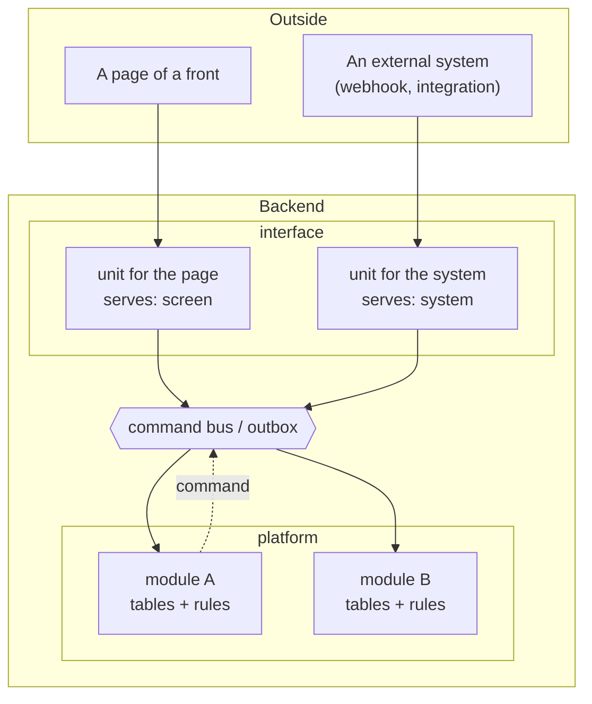
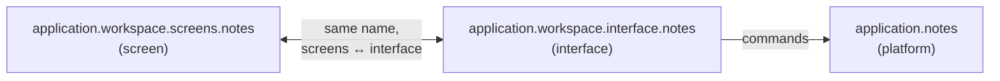

# Architecture

Bucle Engine is a modular monolith. One backend process holds many modules; each module is a
bounded context with its own folder, its own manifest and its own database schema. Modules never
import each other: they exchange commands and events. That keeps the boundaries hard without
paying for a network hop between every pair of modules.

## The three layers

### platform — the sealed core

A platform module owns the tables of its area and the rules of its domain. It has **no routes and
no controller**: its manifest cannot even declare one, because the section that would hold routes
does not exist for this layer. What a platform module offers, it offers as `PublicCommands`; what it
needs from another module, it asks for by command and declares in `SystemRules`.

The question that puts a module here: *does it touch the database and own domain rules?*

### interface — the only door

An interface unit serves exactly one consumer: one screens module of a front, or one external
system. It carries that consumer's name and declares it in `Metadata.serves`. Each of its endpoints
returns what one page needs, in the shape that page needs; when a page shows data from several
platform modules, the unit gathers and condenses it on the server.

An interface unit owns no table and decides no domain rule. It never calls another interface unit,
so switching one off can never silently break another.

The question that puts a module here: *does it serve one front module or one external system by
composing platform modules?*

### screen — the front

A front is a set of screens grouped in modules, each with a small manifest of its own (its
metadata, its controls, its texts). A screen talks only to the interface unit that shares its name.

## The pair: a screens module and its unit

The names line up segment by segment, so the pair is read from the name alone, with no separate
map:

Switching the pair off for a tenant turns off the page and its endpoints together; the platform
module underneath keeps working for everything else that uses it.

## Variability without `if (tenant)`

Tenants differ, and the Engine keeps those differences out of the code paths:

| The difference is… | It goes to… |
|---|---|
| a value a tenant sets (a default, a limit) | `TenantConfiguration` in the manifest |
| a switch inside a module, rolled out gradually | a `FeatureFlag`, always born `false` |
| a decision that depends on the tenant's business | a `BusinessRule`, executed as a command |
| something the system requires regardless of tenant | a `SystemRule` |

The classifier is one question: if the temptation is to write `if (tenant === X)` inside a flow,
that decision is a declared `BusinessRule`, dispatched as a command.

## Products on top

A product pins one tagged version of the Engine and builds around it: its own fronts, its own
connectors to external systems, its own seed data. Backend work a product needs is done in the
Engine first, released, and then pulled into the product; the product never patches its copy.
