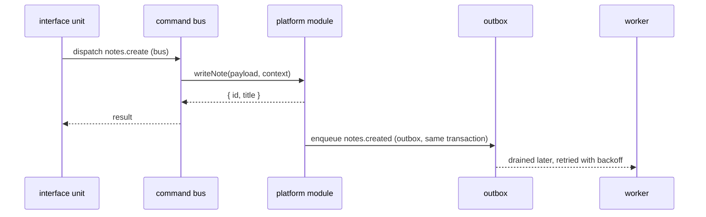

# Commands: how modules talk

Modules never import each other's code. A module that needs something from another one dispatches
a command; the owner of the data answers it. Every command a module offers is declared in its
`PublicCommands`, and every command it consumes is declared in its `SystemRules`. Calling a command
the caller did not declare fails loudly.

## The contract of one command

```ts
{
  commandId: requiredField('application.notes.create', 'command-id', { editable: false }),
  actionType: requiredField('write', 'list', { editable: false }),
  dispatch: { mode: requiredField('bus', 'list', { editable: false }) },
  eventName: field(null, 'string', { editable: false }),
  description: field('Creates a note for the calling user.', 'text', { editable: false }),
}
```

| Field | Meaning |
|---|---|
| `commandId` | the public identity of the operation; dots are the path (plane, area, module, action) |
| `actionType` | `read`, `readAll`, `write` or `delete`; handlers and service methods start with that verb |
| `dispatch.mode` | `bus` answers in the same request; `outbox` is durable and only acknowledges the enqueue |
| `eventName` | the event an `outbox` command emits for its workers |

## bus or outbox



Use `bus` when the caller needs the answer — a decision, a created id. Use `outbox` when the work
may happen later and must not be lost: the enqueue commits with the business write, and a worker
drains it with retries. An `outbox` command cannot decide anything for its caller, because the
caller only learns that it was queued.

## Who may call whom

| From | To | Allowed |
|---|---|---|
| interface unit | platform module, by command | yes — and declared in `SystemRules` |
| platform module | another platform module, by command | yes — and declared in `SystemRules` |
| interface unit | another interface unit | **no** |
| anything outside | a platform module | **no** — only through an interface unit |
| any module | another module's code (import) | **no** |
